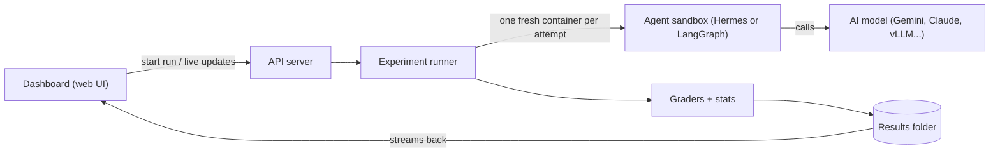
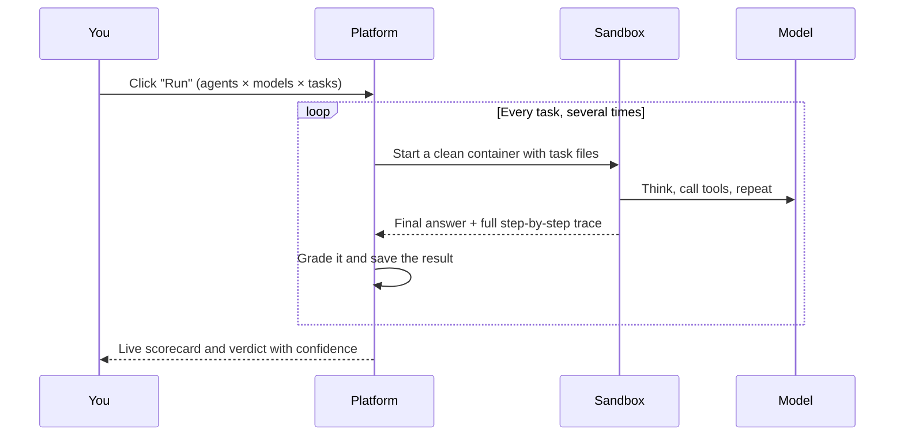

# Architecture

[← Back to Docs](./README.md)

## The Big Picture

The platform has three layers: a **dashboard** where you ask the question, a **control layer** that runs and scores things, and **disposable sandboxes** where the agents actually work.

Everything runs locally with `docker compose up`. Results are plain files on disk, so they survive restarts and the command line and dashboard see the same data.

---

## Key Building Blocks & Adapter Interfaces

- **Harness Adapter (`HarnessAdapter` — the "driver"):** Wraps any agent loop (`hermes`, `langgraph`, or a custom plugin) behind three methods:
  - `prepare_container()` — writes `/io/spec.json` (prompt, model, settings), enabled `skills/`, and optional `seed/MEMORY.md` into the container.
  - `build_command()` — returns the container command to execute.
  - `extract_outputs()` — reads back `/io/result.json` (`status`, `final_answer`, `steps`, `input_tokens`, `output_tokens`) and `/io/trace.jsonl`.
  - *Zero-core-edit extensibility:* New harnesses dropped into `eval_runner/agents/<name>.py` with `@register_adapter` are auto-discovered at startup.
- **Model Adapter (`ModelAdapter` — the "engine"):** Reaches any provider (Gemini, Claude, OpenRouter, Cloud Run vLLM, local Ollama, or `mock`) through a single **LiteLLM** interface (`LiteLLMModelAdapter` + `Router` with automatic HTTP 429 exponential backoff, key rotation, and fallbacks):
  - `build_container_env()` — injects provider API keys and `api_base` into the sandbox container.
  - `complete()` — executes rubric judge and calibration calls with automatic retries.
- **Graders (the "referee"):** Post-run deterministic verifiers (`/grader-tests/test.sh` & `pytest`) and an artifact-aware LLM-as-judge.
- **Stats & Failure Classifier (the "scoreboard"):** Paired bootstrap confidence intervals, exact McNemar's test, and a 12-category rule-based failure taxonomy (`eval_runner/failures.py`).

---

## Data Model (`tasks`, `configs`, `experiments`, `trials`, `traces`)

All entities are validated with Pydantic (`eval_runner/schemas.py`) and persisted as atomic JSON/JSONL files under `results/<experiment_id>/`:

| Entity | Schema / File | Key Fields |
| :--- | :--- | :--- |
| **Tasks** | `TaskSpec` (`tasks/<id>/task.yaml`) | `id`, `category`, `discriminates`, `timeout_sec`, `grader` (`type`, `script`, `rubric`, `artifacts`, `pass_threshold`), plus `instruction.md`, `fixtures/`, `seed/MEMORY.md`. |
| **Configs** | `ConfigSpec` (`configs/*.yaml`) | `name`, `harness`, `model`, `settings` (`temperature`, `max_steps`, `timeout_sec`, `memory`, `skills`, `tools`, token budgets), versioned by a 12-char SHA-256 `config_hash`. |
| **Experiments** | `results/<exp_id>/manifest.json` | `experiment_id`, `created_at`, `n_trials`, `seed`, resolved `configs` (with `config_hash`), `tasks`, and `provenance` (`git_commit`, `image_digests`, `task_hashes`, `litellm_version`). |
| **Trials** | `TrialResult` (`trials/<trial_id>.json`) | `trial_id`, `config_name`, `config_hash`, `task_id`, `trial_index`, `status` (`completed` \| `infra_error`), `score`, `passed`, `runtime_sec`, `input_tokens`, `output_tokens`, `cost_usd`, `steps`, `grade`, `failure_category`. |
| **Traces** | `TraceEvent` (`trials/<trial_id>.trace.jsonl`) | Sequential `seq`, `ts`, `type` (`session_start`, `message`, `tool_call`, `tool_result`, `memory_op`, `skill_invoked`, `model_call`, `error`, `session_end`), and `payload`. |

---

## A Day in the Life of an Experiment

1. **You click Run.** The dashboard switches to a live view and shows a progress bar.
2. **Each attempt gets a clean room.** A brand-new container starts with only that task's files. It is destroyed afterward, so nothing carries over.
3. **The agent works.** Every message, tool call, memory read, and skill use is recorded, so you can replay exactly why an attempt passed or failed.
4. **The referee scores it.** Hidden tests or the AI judge produce a score. Failures are tagged with a cause, such as *missed memory*, *looping*, or *gave up early*.
5. **The scoreboard updates.** Once both sides have results, the platform compares them task by task and reports the difference with a confidence range.

---

## How Runs Are Isolated and Reproduced

- **Container-per-trial isolation (`eval_runner/container.py`):** Every trial attempt runs in a fresh ephemeral Docker container (`mem_limit=4g`, `cpus=2`, `pids_limit=256`, `tmpfs` `/tmp`), with `/root/.hermes` wiped clean and files injected via in-memory tar archives (`put_archive`). A dual watchdog (`timeout --kill-after=5` inside the container + a host kill timer) enforces `timeout_sec`, and a `finally` block + `SIGINT` handler + startup orphan reaper guarantee zero leftover containers.
- **Golden Rule & atomic retry (`eval-retry`):** Each trial writes atomically (`tmp` → rename). Provider rate limits (429/5xx), missing keys, or runner crashes are recorded as `status: "infra_error"` (`score: null`), excluded from stats, and re-run selectively via `eval-retry` without touching completed trials.
- **Deterministic reproducibility:** `compute_config_hash()` hashes the canonical JSON of `{harness, model, api_base, settings}` (excluding `pricing` so price updates don't break historical hashes). `manifest.json` snapshots the git commit SHA, Docker image digests, per-task content hashes, and random seed (used to shuffle trial execution order across configs so time-of-day provider drift never biases one arm).
