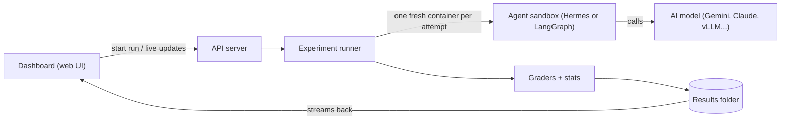
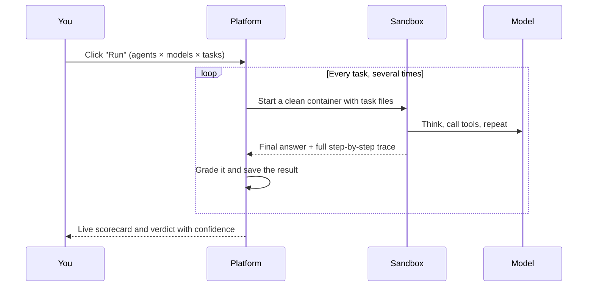

# Architecture

[← Back to Docs](./README.md)

## The Big Picture

The platform has three layers: a **dashboard** where you ask the question, a **control layer** that runs and scores things, and **disposable sandboxes** where the agents actually work.

Everything runs locally with `docker compose up`. Results are plain files on disk, so they survive restarts and the command line and dashboard see the same data.

---

## Key Building Blocks

- **Harnesses: the "driver."** A harness is the agent's operating loop: how it plans, uses tools, reads memory, and loads skills. Hermes and LangGraph are two different drivers. Adding a new one means adding one adapter file, without touching the platform's core.
- **Models: the "engine."** Every model is reached through one shared interface (LiteLLM). Switching from Gemini to Claude to a self-hosted model is a one-line config change.
- **Graders: the "referee."** Most tasks are checked by a script that runs *after* the agent finishes, so the agent can't see or tamper with the answer key. Open-ended writing tasks use an AI judge, which we checked against human labels before trusting it.
- **Stats: the "scoreboard with error bars."** Instead of one pass rate, you get a confidence range and a verdict. If the range includes zero, the platform says **noise** instead of declaring a winner.

---

## A Day in the Life of an Experiment

1. **You click Run.** The dashboard switches to a live view and shows a progress bar.
2. **Each attempt gets a clean room.** A brand-new container starts with only that task's files. It is destroyed afterward, so nothing carries over.
3. **The agent works.** Every message, tool call, memory read, and skill use is recorded, so you can replay exactly why an attempt passed or failed.
4. **The referee scores it.** Hidden tests or the AI judge produce a score. Failures are tagged with a cause, such as *missed memory*, *looping*, or *gave up early*.
5. **The scoreboard updates.** Once both sides have results, the platform compares them task by task and reports the difference with a confidence range.

---

## Two Rules That Keep Results Honest

- **Infrastructure errors never count as failures.** If a provider rate-limits us or a container crashes, that attempt is marked *infra error*, kept out of the score, and can be re-run on its own.
- **Every run is reproducible.** Each experiment records the exact settings, code version, and container versions it used.
