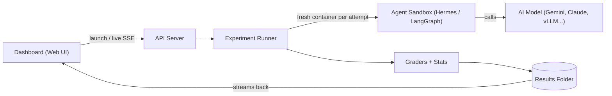
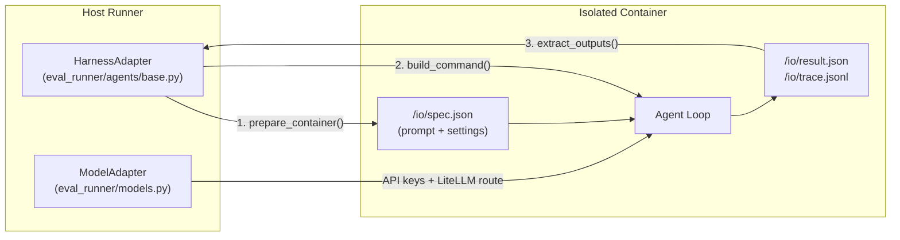
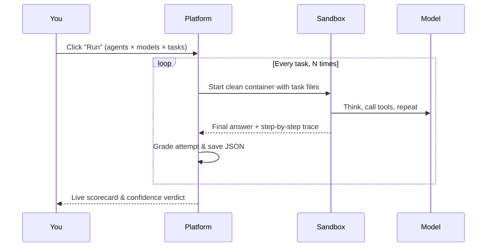

# Architecture

[← Back to Docs](./README.md)

## The Big Picture

The platform has three layers: a **dashboard** where you launch runs, a **control layer** that schedules and scores them, and **disposable sandboxes** where the agents actually work.

Everything runs locally with `docker compose up`. Results are saved as plain files in `results/`, so they survive container restarts and work identically from the UI or CLI.

---

## Key Building Blocks & Adapter Interfaces

Adding a new agent harness or model never touches the platform core—you just plug in an adapter.

- **Harnesses — the "driver"** ([`eval_runner/agents/base.py`](../eval_runner/agents/base.py))
  Wraps any agent loop ([Hermes](../eval_runner/agents/hermes.py) or [LangGraph](../eval_runner/agents/langgraph.py)) behind three steps: copy `/io/spec.json` in, run the agent command, and read `/io/result.json` + `/io/trace.jsonl` back out. Dropping a new file into `eval_runner/agents/` registers it automatically.

- **Models — the "engine"** ([`eval_runner/models.py`](../eval_runner/models.py) & [`models.yaml`](../models.yaml))
  Routes every provider (Gemini, Claude, OpenRouter, Cloud Run vLLM, Ollama, or `mock`) through one shared [LiteLLM](https://docs.litellm.ai/) interface with automatic rate-limit retries and fallbacks.

- **Graders — the "referee"** ([`eval_runner/graders.py`](../eval_runner/graders.py))
  Checks the agent's work after the run finishes using either hidden `pytest` scripts or a calibrated AI judge.

- **Stats & Failures — the "scoreboard"** ([`eval_runner/stats.py`](../eval_runner/stats.py) & [`eval_runner/failures.py`](../eval_runner/failures.py))
  Computes confidence intervals, flags statistical noise, and groups failures into clear categories (*missed memory*, *loop*, *timeout*, *wrong output*).

---

## Data Model

All records are validated in [`eval_runner/schemas.py`](../eval_runner/schemas.py) and stored as plain JSON files under `results/<experiment_id>/`:

| Record | Where It Lives | What It Holds |
| :--- | :--- | :--- |
| **Tasks** | `tasks/<id>/task.yaml` | Prompt (`instruction.md`), starter `fixtures/`, `seed/MEMORY.md`, timeout, and grader rules. |
| **Configs** | `configs/*.yaml` | Harness + model + settings (`temperature`, `max_steps`, `memory`, `skills`), stamped with a SHA-256 `config_hash`. |
| **Experiments** | `results/<id>/manifest.json` | Which configs and tasks were run, trial count `N`, random seed, git commit, and Docker image digests. |
| **Trials** | `trials/<trial_id>.json` | One attempt's status (`completed` or `infra_error`), score, pass/fail, runtime, tokens, cost, and failure reason. |
| **Traces** | `trials/<trial_id>.trace.jsonl` | Step-by-step timeline of messages, tool calls, memory reads/writes, skills used, and errors. |

---

## A Day in the Life of an Experiment

---

## How Runs Are Isolated and Reproduced

- **Clean container every time** ([`eval_runner/container.py`](../eval_runner/container.py))
  Every attempt starts in a brand-new Docker container (capped at 4 GB RAM and 2 CPUs) with agent state wiped clean. When the attempt finishes—or hits the timeout watchdog—the container is destroyed immediately so nothing leaks into the next run.

- **Provider glitches never count as agent failures** ([`eval_runner/runner.py`](../eval_runner/runner.py))
  If an API rate-limits out or a container fails to start, the attempt is marked `infra_error` (not `score: 0.0`), kept out of the averages, and can be re-run on its own with **Retry Infra Errors** (`eval-retry`).

- **Reproducible by default** ([`eval_runner/schemas.py`](../eval_runner/schemas.py))
  Every config gets a fingerprint (`config_hash`), and every experiment records its exact git commit, container image IDs, task file hashes, and random seed in `manifest.json`.
