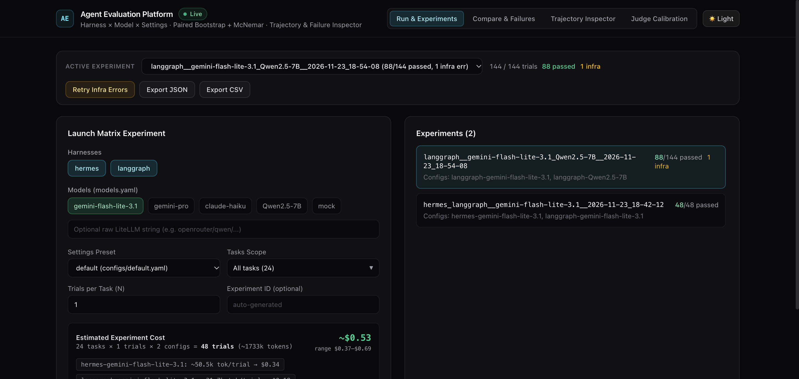
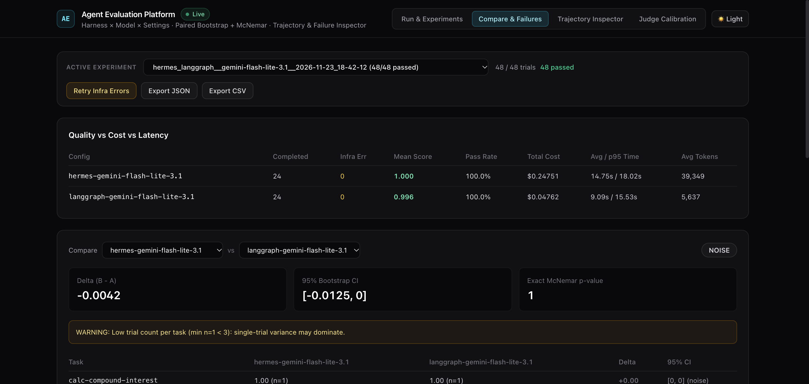
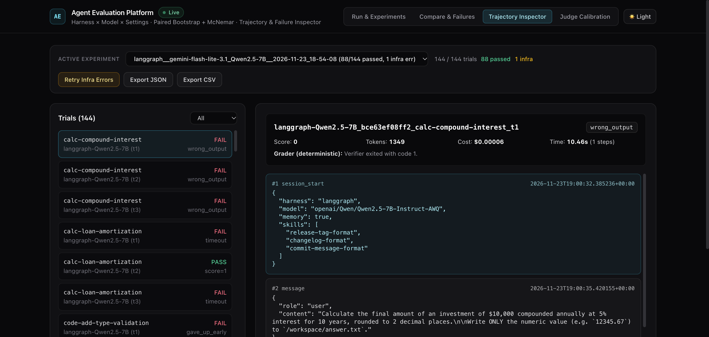

# Benchmark Report: Agent Harness & Model Comparisons

[← Back to Docs](./README.md) · [View Raw Results](../results/) · [View All Screenshots](./screenshots/)

> **TL;DR — Two Experiments, 192 Total Runs**
> 1. **Harness Choice Matters for Cost, Not Accuracy (Exp 1):** With `Gemini Flash Lite 3.1` and memory/skills enabled, **Hermes** and **LangGraph** both passed **24 / 24 tasks (100%)**, but LangGraph was **5.2× cheaper** and **1.7× faster** because of its lightweight prompt.
> 2. **Frontier API Beats Small Open-Weight Models on Reliability (Exp 2):** Using LangGraph across **144 repeated runs (`N = 3`)**, `Gemini Flash Lite 3.1` achieved **100% pass rate (71/71)** vs. **23.6% (17/72)** for self-hosted `Qwen2.5-7B`, which struggled with timeouts and skipped tool calls.

---

## Dashboard & Pre-Run Cost Estimator

Before launching a sweep, the dashboard estimates token usage and spend (`tasks × trials × configs × avg_tokens × rate`) so there are no billing surprises:

---

## Experiment 1: Harness Comparison (`Hermes` vs. `LangGraph`)

**Question:** Using the exact same model (`gemini-3.1-flash-lite`) with memory and all 3 skills enabled across all **24 tasks** (`N = 1`, 48 runs), how much does the agent harness impact performance and cost? ([View Manifest](../results/hermes_langgraph__gemini-flash-lite-3.1__2026-11-23_18-42-12/manifest.json))

| Metric (24 tasks · 48 runs) | Hermes | LangGraph | Takeaway |
| :--- | :---: | :---: | :--- |
| **Pass Rate** | **100.0%** (24 / 24) | **100.0%** (24 / 24) | **Exact tie** (`p = 1.00`, no statistical difference) |
| **Mean Score** | **1.000** | **0.996** | Virtually identical quality (`Δ = -0.0042`) |
| **Median / p95 Runtime** | 13.9s / 18.0s | **8.0s / 15.5s** | LangGraph is **1.7× faster** at median |
| **Avg Tokens per Run** | 39,349 | **5,637** | LangGraph uses **7.0× fewer tokens** |
| **Total Spend** | \$0.2475 | **\$0.0476** | LangGraph is **5.2× cheaper** (saved \$0.20) |

**Key Insight:** Both harnesses solved every memory, skill, coding, and AI-judged task. However, Hermes reloads its full built-in system prompt and tool schemas (~15k tokens) on every step, driving up token usage by 7× compared to LangGraph's lean 4-tool loop.

---

## Experiment 2: Model Comparison (`Gemini Flash Lite 3.1` vs. `Qwen2.5-7B`)

**Question:** Locking in the leaner **LangGraph** harness across all **24 tasks** with **`N = 3` trials per task** (**144 runs**), how does a cloud API (`gemini-3.1-flash-lite`) compare against our self-hosted open-weight model (`Qwen2.5-7B-Instruct-AWQ` on an L4 GPU)? ([View Manifest](../results/langgraph__gemini-flash-lite-3.1_Qwen2.5-7B__2026-11-23_18-54-08/manifest.json))

| Metric (24 tasks × `N = 3` · 144 runs) | Self-Hosted `Qwen2.5-7B` | `Gemini Flash Lite 3.1` | Takeaway |
| :--- | :---: | :---: | :--- |
| **Completed Runs** | 72 completed (0 errors) | 71 completed (**1 `infra_error`**) | Transient API error isolated from score |
| **Pass Rate** | 23.6% (17 / 72) | **100.0%** (71 / 71) | **+76.4% pass rate advantage** |
| **Mean Score** | 0.254 | **0.999** | **Clear winner (`p = 0.0`)** |
| **Median Runtime (`p50`)** | 24.4s | **11.9s** | Gemini is **2.1× faster** |
| **Total Token Spend** | **\$0.0088** | \$0.1367 | Self-hosted is near-zero token cost, but fails 76% of tasks |

### Where `Qwen2.5-7B` Failed (55 Failed Runs)

The evaluator automatically bucketed `Qwen2.5-7B`'s 55 failures into **7 root causes**, making it easy to see *why* the smaller model struggled:
- **Execution & Logic (44 runs):** `timeout` (23) and `wrong_output` (21)
- **Agent Behavior & Tooling (10 runs):** `gave_up_early` (5), `hallucinated_tool_args` (2), `wrong_tool` (2), and `loop` (1)
- **Grading Edge Case (1 run):** `grader_borderline` (1)

*(Meanwhile, `Gemini Flash Lite 3.1` had zero task failures—only 1 transient `infra_error` that was cleanly excluded from scoring.)*

---

## What the Traces Reveal (3 Trajectory Deep Dives)

1. **Skipping Tools for "Mental Math" (`calc-compound-interest`):**
   Both Gemini configs called `run_bash` with Python to compute `10000 * (1.05 ** 10)` and wrote `16288.95`. `Qwen2.5-7B` skipped Python, guessed the math in its head, and wrote `16470.09` (the continuous-compounding formula)—failing the task immediately. ([Qwen trace](../results/langgraph__gemini-flash-lite-3.1_Qwen2.5-7B__2026-11-23_18-54-08/trials/langgraph-Qwen2.5-7B_bce63ef08ff2_calc-compound-interest_t1.trace.jsonl))
2. **14× Token Gap on Memory Recall (`mem-deploy-convention`):**
   Both harnesses found `<env>-<region>-<service>-v2` in `MEMORY.md` and wrote `prod-eu-west-payments-v2`. LangGraph finished in **2,148 input tokens**, while Hermes used **31,205 input tokens** due to its heavier default tool schemas. ([Hermes trace](../results/hermes_langgraph__gemini-flash-lite-3.1__2026-11-23_18-42-12/trials/hermes-gemini-flash-lite-3.1_6d11c02e5407_mem-deploy-convention_t1.trace.jsonl) · [LangGraph trace](../results/hermes_langgraph__gemini-flash-lite-3.1__2026-11-23_18-42-12/trials/langgraph-gemini-flash-lite-3.1_acaef8bddbf8_mem-deploy-convention_t1.trace.jsonl))
3. **Why `Qwen2.5-7B` Timed Out 23 Times:**
   On multi-step coding tasks, the 7B quantized model frequently passed malformed JSON arguments (`hallucinated_tool_args`) or hung on unclosed shell commands until the container watchdog killed the run.

---

## Cost Summary & Optimization Levers

| Experiment | Scale | Actual Spend | How to Cut Costs by 60–85% |
| :--- | :--- | :---: | :--- |
| **Exp 1: Harness Swap** | `24 tasks × 1 trial × 2 configs` (48 runs) | **\$0.2951** | **Enable Prompt Caching:** Avoids re-billing Hermes's ~15k-token system prompt on every step (saves 75–90% on Hermes). |
| **Exp 2: Model Swap** | `24 tasks × 3 trials × 2 configs` (144 runs) | **\$0.1455** | **Early Stopping & Smoke Gates:** Halt loops early and run a 5-task `N = 1` canary check (~\$0.05) before full `N = 3` sweeps. |

---

## Critical Metrics, Assumptions & When NOT to Trust the Conclusions

A raw pass rate alone can hide reliability bugs or produce false winners. Our evaluation pipeline relies on four core assumptions—and explicitly flags scenarios where the platform's conclusions should not be taken at face value:

### 1. Which Metrics Actually Matter
- **Paired Task Delta & Confidence Intervals (over raw averages):** Always compare configs on the exact same completed task subset (`shared_tasks`). A single `HTTP 402` or network blip on 3–4 tasks can swing an unadjusted pass rate by 10–15% and crown a false winner.
- **Consistency Across Trials (`pass^k` vs. `pass@1`):** Running `N = 1` (as in Exp 1) only shows whether an agent *can* solve a task once; `N ≥ 3` (Exp 2) exposes non-deterministic flakiness where a model passes on trial 1 and times out on trials 2 and 3.
- **Cost per *Passing* Task & `p95` Latency:** A cheap model with a 23% pass rate (`Qwen2.5-7B`) is more expensive in production than a frontier API once retries and human intervention are factored in.

### 2. When NOT to Trust the Platform's Conclusions

| Risk Factor | Why It Can Mislead | How to Guard Against It |
| :--- | :--- | :--- |
| **Small Task-Set Size (`24 tasks`) & Saturation** | With 24 tasks, each task equals **4.2%** of the total score. In Exp 1, both harnesses hit **100% (24/24)**—a *ceiling effect* that proves parity on basic workflows, **not** that Hermes and LangGraph are equal on 50-step or long-horizon tasks. | Treat 24-task sweeps as a **regression gate**, not a universal leaderboard. Add harder multi-repo or ambiguous tasks once pass rates exceed 90%. |
| **LLM-as-a-Judge Bias (`5 / 24` subjective tasks)** | Writing and code-review tasks rely on an LLM judge rather than deterministic `pytest` checks. LLM judges exhibit **verbosity bias** (favoring longer answers) and **self-preference bias** (favoring outputs from their own model family). | Keep deterministic checks (`pytest`, exact file/regex match) for 80%+ of the suite, use binary yes/no rubrics for LLM judges, and audit any `grader_borderline` flag manually. |
| **Benchmark & Training Contamination** | Standard coding tasks (e.g., `lru-cache`, `binary-search`, `compound-interest`) appear frequently in public pre-training corpora. High pass rates on classic algorithms may reflect **memorization** rather than live tool-use reasoning. | Weight custom, private tasks (`MEMORY.md` conventions, internal `SKILL.md` formats, bespoke multi-file repos) higher than standard textbook coding problems. |
| **Harness-Specific Quirks & Container Confounders** | Harnesses have asymmetric tool ergonomics: Hermes includes a structured `patch` tool and SQLite session search, while LangGraph relies on raw bash/file edits. Additionally, container cold-starts or rate limits (`infra_error > 10%`) distort latency and completion rates. | Never trust a run when `infra_error` exceeds 10% without running `eval-retry`. Separate **harness overhead** (prompt size, tool schema tokens) from **model intelligence** before blaming a model for timeouts. |
