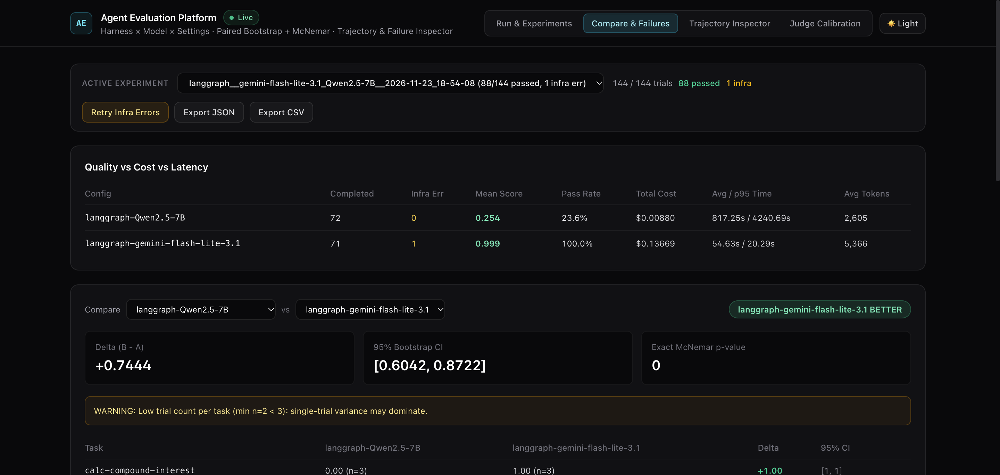
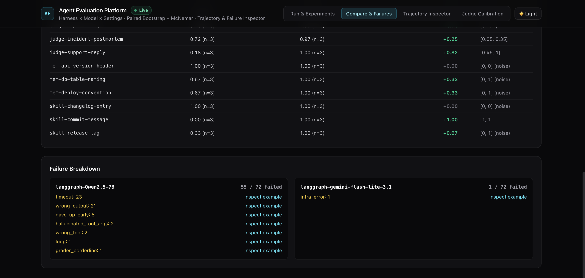

# Experiment Report: Harness & Model Comparisons

[← Back to Docs](./README.md) · **Raw Results:** [`results/`](../results/) · **Screenshots:** [`results/screenshots/`](../results/screenshots/)

---

## Dashboard Overview & Pre-Run Cost Estimator

Before launching an experiment, the dashboard calculates the estimated token usage and dollar cost from `tasks × trials (N) × configs × avg_tokens_per_trial × model_price_per_token`:


---

## Experiment 1: Harness Comparison (`Hermes` vs. `LangGraph`)

**The question:** If we give the exact same model (`gemini/gemini-3.1-flash-lite`) and settings (`memory: true`, all 3 skills enabled in [`configs/default.yaml`](../configs/default.yaml)) to **Hermes** and **LangGraph** across all **24 tasks** (`N = 1`, 48 trials), does the harness change accuracy, speed, or cost?

- **Experiment folder:** [`results/hermes_langgraph__gemini-flash-lite-3.1__2026-11-23_18-42-12/`](../results/hermes_langgraph__gemini-flash-lite-3.1__2026-11-23_18-42-12/manifest.json)


| Metric (All 24 tasks, 48 trials) | Hermes (`6d11c02e5407`) | LangGraph (`acaef8bddbf8`) | Comparison / Verdict |
| :--- | :---: | :---: | :--- |
| **Pass rate** | **100.0%** (24 / 24) | **100.0%** (24 / 24) | **Tie (`verdict: NOISE`, `p = 1.00`)** |
| **Mean score** | **1.000** | **0.996** | `Delta = -0.0042` (`95% CI: [-0.0125, 0.0]`) |
| **Median / p95 runtime** | 13.9s / 18.0s | **8.0s / 15.5s** | LangGraph **1.7× faster** at median |
| **Avg tokens per trial** | 39,349 | **5,637** | LangGraph **7.0× fewer tokens** |
| **Total experiment cost** | \$0.2475 | **\$0.0476** | LangGraph **5.2× cheaper** (saved \$0.20) |

- **Takeaway:** With `memory: true` and `skills` enabled, both harnesses passed **24 / 24 tasks** (including all 3 memory tasks, 3 skill tasks, and 5 AI-judged tasks). However, LangGraph cost **5.2× less** because Hermes loads its full default system prompt and built-in tool schemas (~15k tokens) on every step.

---

## Experiment 2: Model Comparison (`Gemini Flash Lite 3.1` vs. Self-Hosted `vLLM Qwen2.5-7B`)

**The question:** Using the leaner **LangGraph** harness across all **24 tasks** with **`N = 3` repeated trials per task** (**144 total trials**), how does a frontier cloud API (`gemini-flash-lite-3.1`) compare against our self-hosted open-weight vLLM model (`Qwen2.5-7B-Instruct-AWQ` on Cloud Run L4 GPU)?

- **Experiment folder:** [`results/langgraph__gemini-flash-lite-3.1_Qwen2.5-7B__2026-11-23_18-54-08/`](../results/langgraph__gemini-flash-lite-3.1_Qwen2.5-7B__2026-11-23_18-54-08/manifest.json)



| Metric (24 tasks × `N = 3` = 144 trials) | `langgraph-Qwen2.5-7B` | `langgraph-gemini-flash-lite-3.1` | Comparison / Verdict |
| :--- | :---: | :---: | :--- |
| **Completed / Infra errors** | 72 completed / 0 `infra_error` | 71 completed / **1 `infra_error`** | `infra_error` isolated from score |
| **Pass rate** | 23.6% (17 / 72) | **100.0%** (71 / 71) | **+76.4% pass rate gap** |
| **Mean score** | 0.254 | **0.999** | **`Delta = +0.7444`** (`95% CI: [+0.6042, +0.8722]`) |
| **Statistical verdict** | — | **Winner (`p = 0.0`)** | **`langgraph-gemini-flash-lite-3.1 BETTER`** |
| **Median runtime (`p50`)** | 24.4s | **11.9s** | Gemini **2.1× faster** |
| **Total experiment cost** | **\$0.0088** | \$0.1367 | Self-hosted vLLM is near-zero token cost |

### Failure Breakdown Across 72 Open-Weight Trials



- **`langgraph-Qwen2.5-7B` (55 failed out of 72):** Grouped automatically into **7 failure categories**—`timeout` (23), `wrong_output` (21), `gave_up_early` (5), `hallucinated_tool_args` (2), `wrong_tool` (2), `loop` (1), and `grader_borderline` (1).
- **`langgraph-gemini-flash-lite-3.1` (1 failed out of 72):** Only 1 transient API error (`infra_error: 1`), which was excluded from the mean score so it did not penalize the 71/71 passing trials.

---

## 3. What the Traces Reveal (3 Inspected Trajectories)


1. **Why `Qwen2.5-7B` failed `calc-compound-interest` (`wrong_output`):**
   In [`langgraph-Qwen2.5-7B_bce63ef08ff2_calc-compound-interest_t1.trace.jsonl`](../results/langgraph__gemini-flash-lite-3.1_Qwen2.5-7B__2026-11-23_18-54-08/trials/langgraph-Qwen2.5-7B_bce63ef08ff2_calc-compound-interest_t1.trace.jsonl), instead of calling `run_bash` with `python3` to compute `10000 * (1.05 ** 10)`, the 7B model guessed the math in its head and wrote `16470.09` directly via `write_file` (the continuous-compounding value instead of annual `16288.95`). Both Gemini configs ran Python first and wrote `16288.95`.
2. **How `Hermes` vs. `LangGraph` solved `mem-deploy-convention` with 14× different token usage:**
   In [`hermes...mem-deploy-convention_t1.trace.jsonl`](../results/hermes_langgraph__gemini-flash-lite-3.1__2026-11-23_18-42-12/trials/hermes-gemini-flash-lite-3.1_6d11c02e5407_mem-deploy-convention_t1.trace.jsonl) vs. [`langgraph...mem-deploy-convention_t1.trace.jsonl`](../results/hermes_langgraph__gemini-flash-lite-3.1__2026-11-23_18-42-12/trials/langgraph-gemini-flash-lite-3.1_acaef8bddbf8_mem-deploy-convention_t1.trace.jsonl), both recalled `<env>-<region>-<service>-v2` from `MEMORY.md` and wrote `prod-eu-west-payments-v2`. LangGraph called `read_memory` → `write_file` in **2,148 input tokens**, whereas Hermes loaded its built-in skill/memory tool schemas and consumed **31,205 input tokens**.
3. **Why `Qwen2.5-7B` hit 23 timeouts and tool-arg hallucinations:**
   On multi-step coding and bash tasks, the 7B quantized model frequently passed malformed JSON arguments (`hallucinated_tool_args: 2`) or hung on unclosed shell commands until the container watchdog killed the trial (`timeout: 23`).

---

## 4. Cost Formula, Actual Spend & How to Reduce Cost

```text
Estimated Cost = tasks × trials (N) × configs × avg_tokens_per_trial × model_price_per_token
```

| Experiment | Formula (`tasks × N × configs`) | Actual Spend | Cost Reduction Strategies (60–85% savings) |
| :--- | :--- | :---: | :--- |
| **Exp 1 (`Hermes` vs. `LangGraph`)** | `24 × 1 × 2 = 48 trials` | **\$0.2951** (\$0.2475 + \$0.0476) | **1. Prompt caching:** Cuts Hermes's ~15k/step repeated system prefix cost by 75–90%. |
| **Exp 2 (`Gemini` vs. `Qwen2.5-7B`)** | `24 × 3 × 2 = 144 trials` | **\$0.1455** (\$0.1367 + \$0.0088) | **2. Early stopping & tiered `N`:** Stop on repeated bash errors/loops, and run a 5-task `N = 1` smoke gate (~\$0.05) before full `N = 3` sweeps. |
