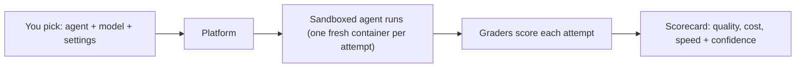

# Agent Evaluation Platform

AI agents change all the time: a new model, a harness upgrade, a skill added, memory turned on. This platform answers one question after every change: **did the agent get better, worse, or stay the same, and how sure are we?**

---

## Why It Matters

A single demo run proves nothing. Agents are random, so one lucky pass can look like a breakthrough and one unlucky fail can look like a regression.

This platform runs every task many times, in clean sandboxes, and tells you whether a difference is **real** or just **noise**.

---

## How It Works



1. **Choose what to compare.** Pick one or more agents (Hermes, LangGraph), models (Gemini, Claude, open-weight), and a settings preset (for example, memory on or off).
2. **Let it run.** Each task runs several times, every attempt in its own throwaway container, so nothing leaks between runs.
3. **Read the verdict.** You get pass rates, cost, and latency side by side, plus a clear call: *A is better*, *B is better*, or *no real difference*.

---

## A Quick Example: Memory ON vs. OFF

Some tasks depend on facts the agent was told earlier, like *"our deploy targets are named `<env>-<region>-<service>-v2`."*

| Setting | What the agent does | Result |
| :--- | :--- | :--- |
| **Memory OFF** | Guesses a name like `payments-prod` | Fails |
| **Memory ON** | Recalls the rule and writes `prod-eu-west-payments-v2` | Passes |

The platform doesn't just say "memory helped." It shows which tasks flipped, how confident that result is, and what the extra tokens cost.

---

## Quickstart

You only need [Docker Desktop](https://www.docker.com/products/docker-desktop/) running.

```bash
cp .env.example .env        # then add an API key, e.g. GEMINI_API_KEY=...
docker compose up           # builds everything (first run takes a few minutes)
open http://localhost:3000  # pick agents, models, tasks → Run Experiment
```

Results stream into the dashboard live as each attempt finishes.

---

## Where to Go Next

- **[ARCHITECTURE.md](./ARCHITECTURE.md):** how the pieces fit together, and what happens when you click "Run".
- **[EXPERIMENT_GUIDE.md](./EXPERIMENT_GUIDE.md):** what we test, how graders and stats work, and when not to trust the numbers.
- **[EXPERIMENT_RESULTS.md](./EXPERIMENT_RESULTS.md):** full scorecard, trace walkthroughs, and conclusions from our Hermes vs. LangGraph experiment (`hermes_langgraph__gemini-flash__2026-11-23_13-32-24`).
- **[Root README](../README.md):** how to add a task, a harness, or a model.
