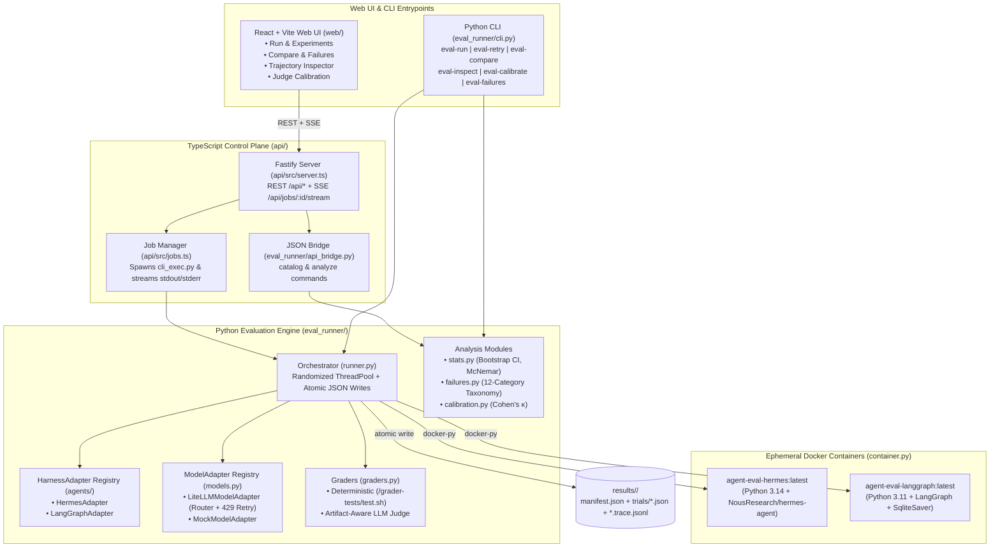

# Agent Evaluation Platform — Documentation Hub

Welcome to the documentation for the **Agent Evaluation Platform**. This platform evaluates any **agent harness ($X$)** running with any **foundation model ($Y$)** and **configuration settings** (`memory`, `skills`, `tools`, `temperature`, step/token budgets) inside isolated Docker containers, answering with statistical evidence:

> **Did the agent get better, worse, or stay the same—and how sure are we?**

---

## Component Documentation Map

To keep the documentation modular and easy to navigate, each subsystem and deliverable is documented in its own dedicated file:

| Document | Scope & Key Topics |
| :--- | :--- |
| **[1. System Architecture](./architecture.md)** | High-level control plane (`api/` + `web/`) and execution plane (`eval_runner/` + Docker workers), trial execution sequence, and Python↔TypeScript bridge. |
| **[2. Harness & Model Adapters](./adapters.md)** | Pluggable `HarnessAdapter` (`hermes`, `langgraph`) and `ModelAdapter` (`litellm`, `mock`) interfaces, auto-discovery, and zero-core-edit extension guides. |
| **[3. Data Model, Isolation & Reproducibility](./data-model-and-isolation.md)** | Pydantic schemas (`ConfigSpec`, `TaskSpec`, `TrialResult`, `TraceEvent`), canonical SHA-256 config hashing, provenance manifests, ephemeral Docker isolation, and `eval-retry`. |
| **[4. Benchmark Tasks, Graders & Judge Calibration](./tasks-and-graders.md)** | The 21-task benchmark suite, post-run isolated deterministic verifiers (`test.sh` / `pytest`), artifact-aware LLM-as-judge, and human calibration (`eval-calibrate`, Cohen's $\kappa$). |
| **[5. Statistical Engine & Failure Taxonomy](./statistics-and-failures.md)** | Paired bootstrap 95% CIs, exact binomial McNemar test, noise & power warnings, choosing $N$, and the 12-category deterministic failure classifier (`eval-failures`). |
| **[6. TypeScript API, Web UI & CLI Reference](./api-and-ui.md)** | Fastify REST + SSE endpoints, background job streaming, React 4-tab dashboard, and complete `uv run eval-*` CLI command reference. |
| **[7. Cost Model, Assumptions & Known Limits](./cost-and-limits.md)** | Analytical cost formula, actual experiment spend breakdown, cost-reduction strategies, explicit engineering assumptions, and statistical/judge trust boundaries. |
| **[8. Real Experiment Report & Trajectories](./experiments.md)** | Empirical comparisons (Hermes vs. LangGraph, memory/skills ablations), paired statistical results, and 3 inspected trial trajectories explaining agent behavior. |

---

## System Overview Diagram

---

## Quick Navigation by Task

- **Run the platform locally with one command:** See [README.md](../README.md) or [TypeScript API, Web UI & CLI Reference](./api-and-ui.md).
- **Add a new agent harness (`X`) or model (`Y`):** See [Harness & Model Adapters](./adapters.md).
- **Add a new benchmark task or grader:** See [Benchmark Tasks, Graders & Judge Calibration](./tasks-and-graders.md).
- **Understand the statistical tests or failure categories:** See [Statistical Engine & Failure Taxonomy](./statistics-and-failures.md).
- **Review the live empirical findings and trace walkthroughs:** See [Real Experiment Report & Trajectories](./experiments.md).
