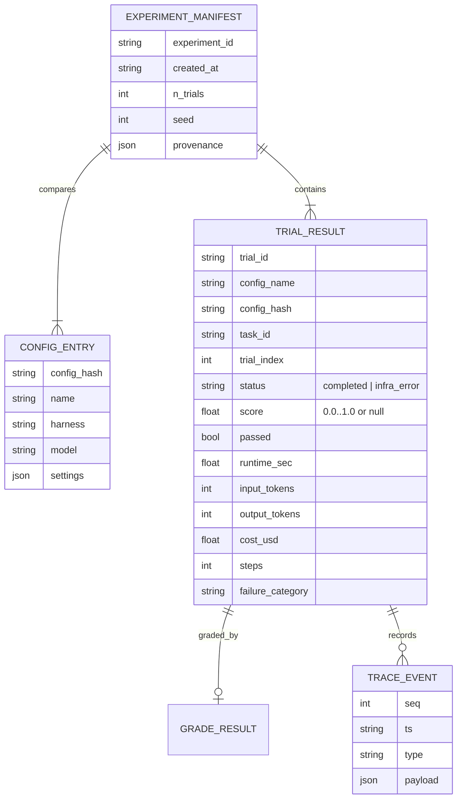

# 3. Data Model, Isolation & Reproducibility

[← Back to Documentation Hub](./README.md) · [← Harness & Model Adapters](./adapters.md)

All schemas live in [`eval_runner/schemas.py`](../eval_runner/schemas.py) using Pydantic v2, and all container lifecycle guarantees live in [`eval_runner/container.py`](../eval_runner/container.py) and [`eval_runner/runner.py`](../eval_runner/runner.py).

---

## 1. Data Model & On-Disk Layout

To keep local deployment dependency-free (no external database service required), every experiment writes self-contained, atomic JSON and JSONL files under `results/<experiment_id>/`:

```text
results/
├── calibration/
│   └── <judge_model>_<timestamp>.json        # Judge calibration reports
└── <experiment_id>/
    ├── manifest.json                         # Config hashes, git SHA, Docker digests, task hashes
    └── trials/
        ├── <trial_id>.json                   # Atomic TrialResult record
        └── <trial_id>.trace.jsonl            # Normalized TraceEvent stream
```



### Core Schema Types ([`eval_runner/schemas.py`](../eval_runner/schemas.py))

1. **`Settings`:**
   - `temperature` (`float`, default `0.2`)
   - `max_steps` (`int`, default `20`)
   - `timeout_sec` (`int`, default `180`)
   - `memory` (`bool`, default `False`)
   - `skills` (`list[str]`, default `[]`)
   - `system_prompt_append` (`str | None`)
   - `tools` (`list[str] | None`, optional tool allow-list)
   - `max_output_tokens` (`int | None`) and `max_total_tokens` (`int | None`)
2. **`ConfigSpec`:** `name`, `harness`, `model`, and `settings: Settings`.
3. **`TraceEvent` (`type` discriminated union):**
   - `session_start`: `{harness, model, memory, skills, ...}`
   - `message`: `{role: "user" | "assistant" | "system", content}`
   - `tool_call`: `{name, args}`
   - `tool_result`: `{name?, output}`
   - `memory_op`: `{op: "read" | "write", target: "MEMORY.md", content?}`
   - `skill_invoked`: `{skill, via}`
   - `model_call`: `{model, input_tokens, output_tokens, ...}`
   - `error`: `{kind: "infra_error" | "agent_error", message}`
   - `session_end`: `{reason: "final"}`

---

## 2. Deterministic Config Versioning & Provenance

### `compute_config_hash(config, model_entry)`
Every configuration is hashed via canonical JSON (`sort_keys=True`, compact separators) into a 12-character SHA-256 hex digest:
- **Included in hash:** `name`, `harness`, `model_id`, `litellm`, `provider`, `api_base` (if set), and `settings`.
- **Excluded from hash:** `pricing` (`input_per_mtok`, `output_per_mtok`). If a provider updates token prices in `models.yaml`, historical config hashes remain stable and reproducible.

### `manifest.json` Provenance Snapshot
At experiment launch, `save_experiment_manifest()` records:
- **Git state:** `git_commit` (`HEAD` SHA) and `git_dirty` boolean.
- **Runtime versions:** `litellm_version` and Docker image SHA-256 digests (`image_digests` for `agent-eval-hermes:latest`, `agent-eval-langgraph:latest`, etc.).
- **Task content hashes:** Per-task SHA-256 hash (`_hash_task_dir`) over every file in `tasks/<task_id>/` (`instruction.md`, `task.yaml`, `fixtures/`, `seed/`, `tests/`).

---

## 3. Trial Isolation & Container Safety (`eval_runner/container.py`)

To guarantee that Trial 1 never leaks files, memory, or processes into Trial 2:

1. **Fresh Ephemeral Container per Trial:** `ephemeral_container()` creates a brand-new container (`aep_trial_<uuid>`) with:
   - `mem_limit="4g"`, `nano_cpus=2_000_000_000` (2 CPUs), `pids_limit=256` (fork-bomb protection).
   - `tmpfs={"/tmp": "size=256M"}`.
   - `/workspace` and `/io` live on the container's ephemeral writable layer (destroyed on container exit) so Docker's `put_archive` writes directly into them without `tmpfs` mount shadowing.
2. **Clean Agent State:** `HermesAdapter` explicitly runs `rm -rf /root/.hermes` before seeding only the enabled skills and (when `settings.memory = True`) the task's `seed/MEMORY.md`.
3. **No Shell-Escaping Injection Bugs:** Files (`spec.json`, `fixtures/`, `MEMORY.md`, `SKILL.md`, and post-run `tests/`) are injected via in-memory `tarfile` streams (`put_files` / `put_directory` → `container.put_archive`), avoiding quote/newline corruption.
4. **Dual Timeout Enforcement (`exec_with_timeout`):**
   - **Inner timeout:** Wraps the container command in `timeout --kill-after=5 <timeout_sec>`.
   - **Outer watchdog:** A host-side `threading.Timer(timeout_sec + 15)` calls `container.kill()` if the container process ignores signals.
5. **Guaranteed Cleanup & Orphan Reaper:**
   - `ephemeral_container()` traps `SIGINT` on the main thread and always executes `container.remove(force=True, v=True)` in its `finally` block.
   - At the start of every experiment, `reap_orphan_containers()` removes any container labeled `aep.managed=true` left behind by a prior hard kill.

---

## 4. Resilience: The Golden Rule & `eval-retry`

> [!IMPORTANT]
> **The Golden Rule of Agent Evals:**
> - **Agent failures** (wrong code, bad tool args, wall-clock timeout, step exhaustion, token budget exceeded) are recorded as `status: "completed"` with `score: 0.0`.
> - **Infrastructure failures** (HTTP 429 rate-limit exhaustion after retries, HTTP 401/403/404/502/503, missing API key, Docker daemon error, or unexpected runner crash) are recorded as `status: "infra_error"` with `score: null`.

- **Atomic Trial Writes (`atomic_write_text`):** Each trial writes to `<trial_id>.json.tmp` and atomically renames via `os.replace()`. If a run crashes on Trial 19 of 20, Trials 1–18 are intact on disk.
- **Selective Retry (`eval-retry --exp <id>`):** `retry_experiment()` inspects `manifest.json` and existing `trials/*.json`, skips all `status == "completed"` trials, and re-executes **only** `infra_error` or missing trials.

---

## Related Documents
- **Next:** [4. Benchmark Tasks, Graders & Judge Calibration](./tasks-and-graders.md)
- **Statistical Handling of `infra_error`:** [5. Statistical Engine & Failure Taxonomy](./statistics-and-failures.md)
